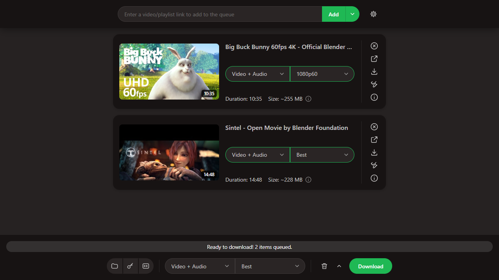

<p align="center"></p>

<h1 align="center">yt-dlp Studio</h1>

<p align="center">A friendly Windows app for downloading video and audio with <a href="https://github.com/yt-dlp/yt-dlp">yt-dlp</a>.<br>
Paste a link, pick a quality, press Download. No command line.</p>

<p align="center"><a href="https://github.com/ytdlpstudiodev/yt-dlp-studio/releases/latest/download/yt-dlp-Studio-Setup.exe"><b>⬇ Download yt-dlp Studio for Windows</b></a>
&nbsp;·&nbsp; <a href="https://github.com/ytdlpstudiodev/yt-dlp-studio/releases">All releases</a></p>

> [!NOTE]
> **This is an AI-generated app.** The code, interface, installer and this README were written by an AI model
> (Anthropic's Claude) through Claude Code, then tested by running them. Review it as you would any software from the
> internet before trusting it with your files.



---

## Download and install

1. **Download the installer:** click
   [**yt-dlp-Studio-Setup.exe**](https://github.com/ytdlpstudiodev/yt-dlp-studio/releases/latest/download/yt-dlp-Studio-Setup.exe)
   (or open the [Releases page](https://github.com/ytdlpstudiodev/yt-dlp-studio/releases), choose the newest release, and
   under **Assets** click `yt-dlp-Studio-Setup.exe`).
2. **Run it.** Windows will probably show a blue **"Windows protected your PC"** box, because the installer isn't
   code-signed (signing certificates cost money). Click **More info → Run anyway**. You can check that your file is
   genuine against `SHA256SUMS.txt` on the release page.
3. **In Setup:** keep or change the install location, tick or untick **Create a desktop shortcut**, and click **Install**.
   No administrator rights are needed; it installs just for your Windows account.
4. **Install Python if Setup asks for it.** yt-dlp Studio runs on Python 3.10 or newer. Setup tells you whether it
   found one. If not, get it from [python.org/downloads](https://www.python.org/downloads/windows/) (the default
   options are fine), or run `winget install Python.Python.3.12`.

### Recommended extras

| Tool | Why | Install (in a terminal) |
|---|---|---|
| **ffmpeg** | Needed to merge HD video with its audio and to convert to MP3 and similar formats | `winget install Gyan.FFmpeg` |
| **Deno** or **Node.js** | YouTube needs a JavaScript runtime to unlock every quality | `winget install DenoLand.Deno` |

yt-dlp itself is included and can be updated from inside the app (**Settings › System › Update**).

---

## Using it

1. **Choose where downloads go:** click the **folder icon** in the bottom bar (Locations) and press **Browse**.
   You only do this once. There is no default folder; Studio asks before the first download.
2. **Add links:** paste a link in the top bar and press **Add**. You can also:
   - paste anywhere in the window, or drag links in from your browser;
   - use **▾ › Watch clipboard**, so every link you copy anywhere goes straight into the queue;
   - use **▾ › Import links** to load a `.txt` file with many links.
3. **Pick what you want** on each card: **Video + Audio**, **Audio** or **Video**, and a quality (Best, 1080p60, 720p,
   160kbps…). Duration and estimated size are shown. The selector in the bottom bar changes every item at once.
4. **Press Download** in the bottom bar for everything, or the download icon on one card.

When it's done, use **Show folder** or **Open file** on the card.

**The icons on each card:** Remove · Open the original page · Download / Pause / Resume / Retry ·
Preferences (pick exact video and audio streams) · Info (details and the full yt-dlp log).

**The bottom bar:** overall progress · **Locations** · **Log in** · **Subtitles** · quality for all items ·
🗑 clear menu (clear finished / failed / pending, pause or cancel all) · **Download**.

### Logging in to sites

Some videos need an account: members-only, private, age-restricted or paid content. Click the **key icon** in the bottom bar:

- **Sign in inside Studio (recommended):** pick a site (YouTube, Patreon, Vimeo, Twitch, Instagram, X, Facebook,
  TikTok, Reddit, Nebula) or type any website. A private browser window opens. Log in as usual and close the window,
  and Studio saves the login automatically and uses it for downloads. This window is separate from your normal browser.
- **Other options:** a `cookies.txt` file, cookies from Firefox, or a username / password / video password for sites
  that support it (passwords are encrypted with your Windows account).

> [!TIP]
> For YouTube, consider signing in with a secondary Google account. Google can flag accounts used with download tools.

### Settings

- **Locations:** download folder, file naming (Title, Title [ID], Channel - Title, Upload date - Title, or your own
  template), and what happens **if the file name already exists**: **Keep both** (saves `Title (2).mp4`, the default),
  **Skip** or **Overwrite**.
- **Subtitles:** choose languages, include auto-generated ones, embed them into the video, SRT/VTT/ASS.
- **Settings › Downloads:** downloads at once, video format (MP4/MKV/WebM), audio format (MP3/M4A/Opus/FLAC/WAV),
  whole playlists or just the video, embed thumbnail/metadata/chapters, cut sponsor segments (SponsorBlock), never
  download the same video twice, start automatically.
- **Settings › Network:** speed limit, proxy (for example a SOCKS5 address from your VPN provider), extra yt-dlp arguments.
- **Settings › App:** dark/light theme, notifications when downloads finish, clipboard watching.

---

## Uninstall

Open **Settings › Apps › Installed apps**, find **yt-dlp Studio** and choose **Uninstall** (or run
`Uninstall yt-dlp Studio.exe` in the install folder). It removes everything Studio created:

- the app and its settings;
- saved logins and its private browser profiles;
- the shortcuts and its Windows registry entry;
- unfinished temporary downloads.

**Your downloaded videos and music are never deleted.**

## Privacy

Everything runs on your computer. Studio has no accounts, analytics, telemetry or crash reporting. It only talks to the
sites you download from, to GitHub when you ask it to download or update yt-dlp, and to SponsorBlock if you turn that on.
Logins are stored only on your PC, inside the install folder.

## Troubleshooting

| Problem | Fix |
|---|---|
| "Windows protected your PC" | Click **More info → Run anyway** (the installer isn't code-signed). |
| "yt-dlp Studio needs Python" | Install Python 3.10+ from python.org, then start Studio again. |
| YouTube downloads fail or only low qualities appear | **Settings › System › Update** yt-dlp, and install Deno or Node.js. |
| "Sign in to confirm…" / members-only errors | Log in with the key icon (see *Logging in to sites*). |
| HD videos have no sound, or MP3 conversion fails | Install ffmpeg: `winget install Gyan.FFmpeg`. |
| Need details on a failure | Click the **ⓘ** icon on the card, then **Logs**. |

---

## What's new in 2.0

- **Installer and uninstaller.** A normal Windows Setup with Start menu entry, optional desktop shortcut and a clean
  uninstaller. No admin rights needed.
- **New interface**, inspired by Open Video Downloader: a link bar, a card per link with track and quality pickers,
  sizes and durations, and a bottom bar with overall progress.
- **Sign in to sites** inside the app for members-only, private, age-restricted and paid content, plus cookies.txt,
  username/password and video passwords.
- **Pause and resume** downloads, and pause, resume or cancel everything at once.
- **Subtitles page** with language selection, auto-generated captions and embedding.
- **More formats:** MP4/MKV/WebM video, and MP3/M4A/Opus/FLAC/WAV audio.
- **Proxy support**, dark/light theme, Windows notifications, and an import-links-from-file option.
- **Settings apply when you press Download**, so changing Locations or Settings affects items that haven't started yet.
- Choosing an **exact stream** is now under each item's Preferences.

## Run from source or build the installer yourself

```
python app.py                 # starts the app (Windows, Python 3.10+, standard library only)
python installer\build.py     # builds dist\yt-dlp Studio Setup.exe
```

The installer is built with the C# compiler that ships with Windows (`csc.exe` from .NET Framework 4), so there is
nothing extra to download. Release builds are made by [GitHub Actions](.github/workflows/release.yml) from this
repository's code, and the latest official `yt-dlp.exe` is bundled at build time.

| Path | Contents |
|---|---|
| `app.py` | Local web server (127.0.0.1 only, per-launch token) and app window |
| `jobs.py` | Download queue, progress, pause/resume, keep-both file placement |
| `ytdlp_core.py` | Quality choices and option → yt-dlp argument mapping |
| `login.py` | In-app sign-in window and cookie export |
| `winutil.py` | Clipboard, folder pickers, Windows DPAPI encryption |
| `web/` | The interface (plain HTML/CSS/JS) |
| `installer/` | Icon generator, launcher, setup and uninstaller sources, `build.py` |

---

## Responsible use

yt-dlp Studio is a general-purpose tool. **You are responsible for how you use it.** Only download content you own,
that is in the public domain or under a licence that allows it, or that you otherwise have permission to download,
and follow the terms of service of the sites you use. Downloading copyrighted material without permission may be
illegal where you live. This project does not circumvent DRM.

yt-dlp Studio is **not affiliated** with the yt-dlp project, with Open Video Downloader, or with any site it can
download from. The screenshot shows *Big Buck Bunny* and *Sintel* by the Blender Foundation (CC BY).

## License

Released into the public domain under [The Unlicense](LICENSE), the same licence yt-dlp uses. Provided "as is",
without warranty of any kind.
